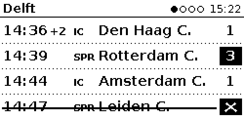
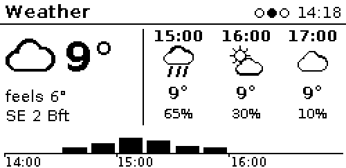
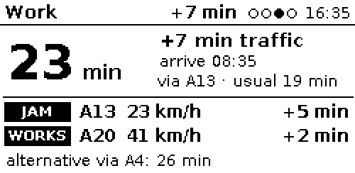
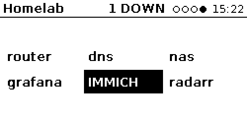

# deskink

A multi-page e-ink dashboard for under a monitor: a **Raspberry Pi Zero 2 W** and a **Waveshare 2.13"
e-Paper HAT V4** (250×122, black/white). It rotates through pages, each shown for its own duration
(30 s by default), and sleeps during quiet hours.

| Trains | Weather |
|---|---|
|  |  |
| **Commute** | **Homelab** |
|  |  |

*Rendered from the bundled sample data with `deskink render --all --fixtures`.*

- **Trains:** the next departures from a Dutch station, from the NS API. Shows the delay, the category
  and the track. A changed track is inverted and a cancelled train is struck through.
- **Weather:** the current conditions plus the next three hours, from Open-Meteo (no API key). The bottom
  strip is the rain forecast in 15-minute bars.
- **Commute:** live car travel time to work from TomTom. Shows the minutes lost to traffic (against empty
  roads), the usual time for this hour, the arrival time, the jams and road works on the route with their
  delay, and optionally an alternative route. The travel time turns inverted once it is
  `alert_delay_min` worse than usual, so ordinary rush hour doesn't trigger it.
- **Homelab:** up to 18 health checks (HTTP, TCP or a Prometheus query) as tiles. A service that is
  **down** turns into a black tile, and one that hasn't answered yet shows dotted with a `?`.

## Hardware

| Part | Notes |
|---|---|
| Raspberry Pi Zero 2 W | With a 40-pin header (the *WH* version, or solder one on) |
| Waveshare **2.13" e-Paper HAT V4** | Check for the **V4** sticker. Other revisions need a different driver file |
| microSD card, 8 GB or more | |
| 5 V micro-USB power supply | |

## Install on the Pi

Start from **Raspberry Pi OS Lite (64-bit)**, Debian 13 trixie, flashed with Raspberry Pi Imager (SSH
and Wi-Fi set there). Then:

```bash
sudo apt-get install -y git
sudo git clone https://github.com/Alpostros/deskink /opt/deskink
sudo /opt/deskink/deploy/install.sh
```

The install script is safe to re-run. It:
1. installs Pillow, spidev, gpiozero and lgpio from apt (no pip)
2. turns on SPI
3. downloads the three Waveshare driver files, pinned to one upstream commit
4. creates the `deskink` system user
5. creates `/etc/deskink/config.toml` from the example, and an empty `/etc/deskink/deskink.env`
6. turns Wi-Fi power save off from the next boot
7. installs, enables and starts `deskink.service`

Then edit the config and add the NS key:

```bash
sudoedit /etc/deskink/config.toml
sudoedit /etc/deskink/deskink.env
sudo systemctl restart deskink
```

`deskink.env` holds one `NAME=value` line per API key. The file is mode 600 and only systemd reads it.

| Key | For | Where |
|---|---|---|
| `NS_API_KEY` | trains | Free at [apiportal.ns.nl](https://apiportal.ns.nl/): subscribe to the *Ns-App* product, which includes the travel-information API |
| `TOMTOM_API_KEY` | commute | Free at [developer.tomtom.com](https://developer.tomtom.com/), no credit card. The free tier is 20,000 route calculations a month; with `refresh_every = 300` the page uses about 6,000 |

**Update** with `sudo /opt/deskink/deploy/update.sh`, which does a `git pull` plus a restart.
**Logs:** `journalctl -u deskink -f`.

## Configuration

See [config.example.toml](config.example.toml). The basics:

```toml
default_duration = 30                 # seconds per page, unless a page sets its own

[display]
full_refresh_every = 20               # page switches between full refreshes (they flash; partials don't)
flip = false                          # rotate 180°

[quiet_hours]
start = "00:30"
end = "07:00"
show = "blank"                        # or a page title, to freeze on that page

[[pages]]
type = "trains"
duration = 45
station = "DT"
```

| Page | Options |
|---|---|
| `trains` | `station` (required, NS station code), `rows` (4), `min_minutes` (0; hides trains you can't catch), `only_destinations`, `exclude_destinations`, `abbreviate` (true), `api_key_env` (`NS_API_KEY`) |
| `weather` | `latitude`, `longitude`, `timezone` (`Europe/Amsterdam`), `rain_full_scale` (2.0 mm per 15 min for a full bar) |
| `homelab` | `checks` (required, up to 18), `prometheus` (base URL, for `prom` checks), `timeout` (3 s), `fail_threshold` (2) |
| `commute` | `origin`, `destination` (required, `[lat, lon]`), `alternatives` (1; 0–2), `alert_delay_min` (10), `travel_mode` (`car`), `api_key_env` (`TOMTOM_API_KEY`). `refresh_every` defaults to 300 and can't go below 60 |
| `clock` | none; a demo page |

Every page also takes `title`, `duration`, `refresh_every` and `enabled`. The same type can appear
more than once, for example two stations, or a second homelab page.

**Homelab checks.** Each check has a `name` plus exactly one of:
- `url`: up if the status is below 400. Optional `contains = "text"`, and `insecure = true` for a
  self-signed certificate.
- `tcp = "host:port"`: up if the port accepts a connection.
- `prom = 'up{job="x"}'`: up if every sample is non-zero. It shows as unknown if Prometheus can't be
  reached.

A check only turns black after `fail_threshold` failures in a row. Probe IP:port directly: a hostname
behind forward auth answers with the login redirect, not the app.

## How it runs

- Each page's data is fetched **while the page before it is on screen**, and only if it is older than the
  page's `refresh_every`. A slow API never delays a page switch.
- **A fetch fails:** the last good data stays up with `stale 4m` in the header.
- **No data at all:** an error card.
- **A bug in a page:** an error card, and the loop keeps going.
- **Page switches use a partial refresh:** about 0.3 s, no flash. Every `full_refresh_every` switches,
  and when quiet hours end, there's a full refresh against ghosting. The full-refresh sequence is
  `sleep()` → `init()` → `displayPartBaseImage()`. The driver only closes SPI in `sleep()`, so
  re-initialising without it leaks a file handle each time.
- **Quiet hours:** one full refresh to the quiet frame, then the panel sleeps. Nothing is fetched until
  the window ends.
- **On `systemctl stop`:** the panel shows `stopped` with the time. The header clock is the render time
  of each frame, so a frozen clock means a hung process.

## Develop on a Mac

```bash
python3 -m venv .venv && .venv/bin/pip install -e ".[dev]"
.venv/bin/deskink -c config.example.toml render --all --fixtures   # PNGs in preview/, plus @3x copies
.venv/bin/deskink -c config.example.toml run --display png         # rotates into screen.png
.venv/bin/pytest -q && .venv/bin/ruff check .
```

`render` without `--fixtures` fetches live data. Put the real config in `./config.toml` and the API keys in
`./.env`; both are gitignored. Load the keys without printing them:
`set -a && . ./.env && set +a && .venv/bin/deskink render --all`.

Home and work coordinates belong only in the private config. TomTom's raw response contains the full
route geometry, so a recorded commute fixture goes through `deskink.pages.commute.scrub()` before it's
committed. The bundled one is synthetic and has no coordinates at all.

## Adding a page

Create `src/deskink/pages/<name>.py`. It's picked up automatically:

```python
from ..net import get_json
from ..render.fonts import font
from .base import Canvas, Page, register


@register("quote")
class QuotePage(Page):
    title = "Quote"
    refresh_every = 3600
    options_allowed = ("url",)

    def fetch(self):
        return get_json(self.opt("url", required=True))

    def sample(self):
        return {"text": "Hello"}

    def render(self, data, c: Canvas):
        c.draw.text((c.x + 4, c.y + 4), data["text"], font=font(14, True), fill=0)
```

Then add `[[pages]] type = "quote"` to the config. What each method does:
- `fetch()` may raise. It runs on a background thread.
- `render()` only draws the body area. The header (title, page dots, clock, status) is drawn for you.
- `status(data)` can return a short string for the header.
- `sample()` feeds `render --fixtures` and the tests.

## Troubleshooting

- **The screen stays blank:** stop the service and run the panel self-test:
  `sudo systemctl stop deskink && sudo -u deskink env PYTHONPATH=/opt/deskink/src
  DESKINK_DRIVER_DIR=/opt/deskink/vendor python3 -m deskink selftest`.
  - A real panel takes about 2 s for a full refresh.
  - If it reports a few hundred ms, the panel isn't answering; the driver never notices that. Check the
    flex-cable latch, the HAT seating (pin 1 over pin 1) and the header solder joints.
- **Trains or commute says `$NS_API_KEY` / `$TOMTOM_API_KEY is not set`:** add it to
  `/etc/deskink/deskink.env` and restart.
- **Commute says `HTTP Error 403`:** the TomTom key is wrong, or the free tier is used up for the month.
- **A homelab tile shows `?`:** it hasn't answered since start-up yet, or (for a `prom` check)
  Prometheus is unreachable.

## Credits

- [DejaVu fonts](https://dejavu-fonts.github.io/) are bundled (see `src/deskink/assets/fonts/LICENSE-DejaVu`).
- The Waveshare driver comes from [waveshareteam/e-Paper](https://github.com/waveshareteam/e-Paper) at
  install time.
- Weather data by [Open-Meteo.com](https://open-meteo.com/) (CC BY 4.0). Train data from the
  [NS API](https://apiportal.ns.nl/). Traffic and routing by [TomTom](https://developer.tomtom.com/).

MIT license.
